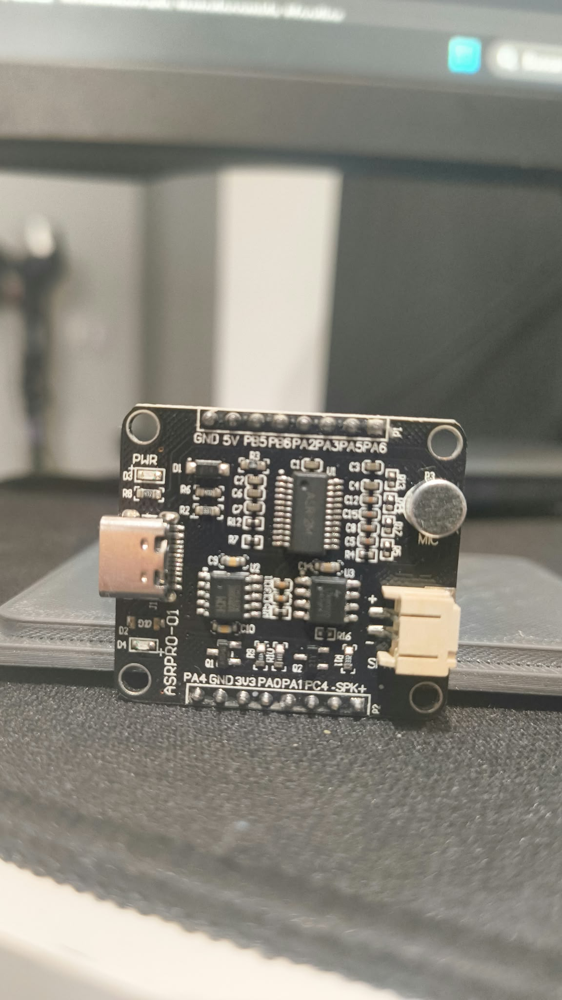

<div align="center">

# ASRPRO Studio

**Your voice. Your commands. Your ASRPRO-01.**

Configure, compile, flash and teach voice commands. One local workspace.

[**English**](README.md) · [Español](README.es.md)


[Download for Windows](https://github.com/adriviciano/ASRPRO-Studio/releases/latest) · [Quick Start](#quick-start) · [Development](#development)

</div>

---

> **Manufacturer tools are external.** Neither the current executable nor this source repository bundles Tianwen Block, its SDK, models or compiler. Studio locates them on your PC or offers the official installer. MIT covers our own code only. See [Third-Party Notices](THIRD-PARTY-NOTICES.md).

## From USB to Voice

| Step | What happens |
| :--- | :--- |
| **0 · Connect** | Select your board's USB serial port. |
| **1 · Define** | Set command names and UART output messages. |
| **2 · Compile** | Generate firmware for the saved configuration. |
| **3 · Flash** | Upload and wait for verification and board confirmation. |
| **4 · Teach** | Say each phrase into the board's microphone, then repeat when prompted. |

Click a step to return or advance when its requirements are met. With no connected board, only step 0 is shown. If the board confirms matching commands, you can go straight to recording.

**Typing a phrase does not teach it to the board.** Record through the ASRPRO-01 microphone, not the computer microphone.

## Quick Start

### One Executable, External Manufacturer Tools

`ASRPRO-Studio.exe` includes the application and Node.js, but
no Tianwen Block installer or manufacturer SDK. It detects a compatible Tianwen
installation beside the executable or in common installation locations. If none
is found, choose an existing folder or consent to download the official 816 MB
installer. You review its license and Windows permission prompts yourself.
The verified version is 2025-1a0907; unexpected downloads are rejected by SHA-256.
Studio creates its own SDK workspace without modifying the original installation.
Requires Windows x64, .NET Framework 4.5+, a browser and the CH340 USB driver.
The startup/download assistant is always English; the application remains English/Spanish.
First launch extracts the application under `%LOCALAPPDATA%\ASRPRO`; subsequent launches reuse it.
Keep the launcher open while using Studio. Closing it stops its local server.

1. Download `ASRPRO-Studio.exe` from the [latest release](https://github.com/adriviciano/ASRPRO-Studio/releases/latest).
2. Run it from a writable folder. No adjacent `app` or `runtime` folders are needed.
3. Let Studio detect Tianwen Block, select its folder, or approve its download and interactive installation.
4. Connect the ASRPRO-01 with a USB data cable and follow the guided steps.

| Requirement | Details |
| :--- | :--- |
| System | Windows x64 |
| Launcher | .NET Framework 4.5 or later |
| USB | CH340 driver and a USB data cable |
| Folder | Short and writable; long paths can break the manufacturer compiler |
| Runtime | Node.js included; no separate installation needed |

### Windows Security Warning

The executable is **not digitally signed**. Windows SmartScreen may show "Windows protected your PC" or an unknown-publisher warning because the application has no established reputation. This is not, by itself, a malware detection. Download only from this repository and compare SHA-256 with the release notes. If Defender reports a named threat, do not assume it is harmless or disable protection: stop and report the exact detection.

> **Before flashing:** uploading firmware erases learned phrases. The app asks for confirmation and saves a backup under `app/output/backups`. Do not disconnect USB during flashing. The package does not include personal recordings or board backups.

## Built for the ASRPRO-01

- Guided setup by default, with an advanced workspace at `/avanzado`.
- **1 to 10 commands**, customizable phrases and output messages.
- Optional activation phrase.
- Recording feedback: listening, repeat, learned and retry.
- Project import/export and recognition activity.
- Firmware checks using CRC and read-back verification.
- English and Spanish. English by default unless the primary system/browser language is Spanish; switch language during the session.
- Learning and recognition run on the board. The application does not upload microphone recordings to a cloud service.

<details>
<summary><strong>View the supported board</strong></summary>

<p align="center">

</p>

Tested with the pictured ASRPRO-01. Other boards and revisions are not guaranteed.

</details>

## Connect Your Project

Command output uses UART at **115200 baud, 3.3 V logic**.

| ASRPRO-01 pin | Role |
| :--- | :--- |
| `PB5` | TX: command output |
| `PB6` | RX: incoming communication |
| `GND` | Common ground with the receiver |

For a receive-only ESP32 monitor: **PB5 → GPIO27**, **GND → GND**. Use the [serial monitor example](esp32/monitor-voz/monitor-voz.ino). The [controller example](esp32/control-voz/README.md) processes specific commands.

Recognition can emit your configured message and `CMD:<id>`. The receiving controller decides what action to perform. ASRPRO Studio is not tied to any particular appliance.

## Development

The supported end-user workflow runs through the executable, including when you build it yourself. Building Studio does **not** require Tianwen or the SDK. Compiling board firmware later does require those external tools; the launcher handles discovery and setup.

Use a Node.js version compatible with the dependencies. The portable package uses **Node.js 24.15.0**.

```powershell
npm ci
npm test
powershell -NoProfile -ExecutionPolicy Bypass -File scripts/build-exe.ps1
```

Build on Windows x64 with Node.js 24.15.0, npm and .NET Framework 4.5+ (including its C# compiler). The result is `releases/ASRPRO-Studio.exe`; run it to set up external tools and open Studio. Packaging installs production dependencies into an isolated staging folder and embeds Node.js with its license. It never copies `vendor`, personal commands or backups. Use `-OutputDirectory C:\ASRPRO-build` for another output folder; existing executables are not overwritten.

For frontend/backend development only, `npm run dev` opens [http://127.0.0.1:5187/](http://127.0.0.1:5187/). Firmware features need a compatible local SDK at `vendor/asrpro`; the development server does not run the launcher's setup assistant. The server binds only to localhost. `/` is guided mode, `/avanzado` is advanced mode, and `/guiado` is a guided-mode alias.

| Folder | Contents |
| :--- | :--- |
| `src/app` | Angular 17 interface, services and translations |
| `server` | Local API, compiler integration and serial programmer |
| `firmware` | Custom ASRPRO firmware |
| `esp32` | Serial monitor and controller examples |
| `scripts` | Windows launcher, packaging and release checks |

New installations use [voice-commands.example.json](voice-commands.example.json). Saving creates `voice-commands.json`, excluded from Git. Existing local configurations are preserved.

### Check and Package

The current locked dependencies report npm security advisories (including high-severity production advisories). This release is not a security audit; dependency upgrades and their compatibility need a separate review. Keep the service local and do not expose it to a network.

```powershell
npm test
npm run check
npm run build
powershell -NoProfile -ExecutionPolicy Bypass -File scripts/build-exe.ps1
```

Packaging requires no SDK and a fresh output executable path. Firmware-layout integration tests need local compilation artifacts; they are skipped when absent. Run `releases\ASRPRO-Studio.exe --self-test` to check startup with an existing compatible Tianwen installation, without opening the installer or flashing a board. The full installation workflow on a PC without Tianwen has not yet been tested end to end.

## Troubleshooting

| Symptom | First check |
| :--- | :--- |
| No serial port | Data cable, CH340 driver, another app holding the port |
| Compiler cannot find headers | Extract to a shorter path; keep package folders together |
| No recognition after flashing | Record again; flashing clears learned templates |
| Phrase rejected | Wait for the listening prompt; repeat clearly with similar tone and distance |
| Recording step locked | Connect and verify that board firmware matches the saved commands |

## License and Credits

Our source code is [MIT](LICENSE). Node.js, JavaScript dependencies, the RISC-V compiler, ASRPRO SDK, models and programming agent retain their own licenses and notices.

An independent project, not an official manufacturer application. Compilation and flashing use manufacturer tools, but do not require running the original graphical program.

External manufacturer tools keep their original terms and are not covered by MIT. Excluding their files does not constitute a complete licensing audit of dependencies or SDK integration code. Attribution does not replace permission.
